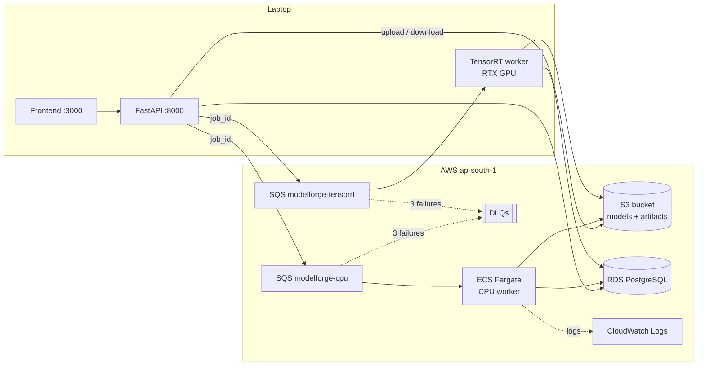

# AWS Architecture

`AWS_MODE=aws` runs ModelForge against real AWS services. The Terraform in
`infrastructure/terraform/` creates them. It is sized for a $100 student credit, so
there is no NAT gateway, no load balancer and no cloud GPU.



## How a conversion flows

1. The user uploads a model: the API stores it in S3 and records it in RDS.
2. The user clicks Convert: the API creates one job row per format and sends
   `{"job_id": ...}` to SQS. TensorRT jobs go to `modelforge-tensorrt`, everything else
   (TFLite, ONNX baseline, Core ML) to `modelforge-cpu`.
3. A worker receives the message, downloads the model from S3, converts and benchmarks
   it, uploads the result to S3 and writes status, logs and benchmark rows to RDS.
4. The frontend polls the API, which reads RDS; downloads stream through the API from S3.

Every worker runs the same pipeline (`backend/app/workers/conversion_worker.py`) as
local mock mode, one job at a time. Cancel works across machines: the API marks the job
CANCELLED in RDS and the worker checks that before every stage.

## Resources and cost

| Resource | Purpose | Cost |
|---|---|---|
| S3 bucket (private) | Uploaded models and converted artifacts | ~$0 at this size |
| SQS `modelforge-cpu`, `modelforge-tensorrt` + DLQs | Job queues; a job failing 3 times goes to its DLQ | ~$0 |
| RDS PostgreSQL db.t4g.micro | Shared database for the API and all workers | ~$15/month, always on |
| ECS Fargate CPU worker (1 vCPU, 4 GB) | TFLite + ONNX baseline + Core ML jobs | ~$0.06/hour while running |
| ECR repository | The CPU worker image | cents |
| IAM roles | Worker can only use the bucket and its own queue | free |
| CloudWatch Logs (7 days) | Worker logs | cents |

The database is reachable only from `my_ip_cidr` (the laptop) and the ECS workers.
TensorRT runs on the laptop because an engine only runs on the GPU model it was built
on, and a cloud GPU would exceed the budget.

## Commands

```powershell
# Create / update the infrastructure (review the plan first)
cd infrastructure/terraform
terraform plan -out=tfplan
terraform apply tfplan

# Stop the Fargate worker cost: set cpu_worker_count = 0 in terraform.tfvars, then plan + apply
# Remove everything (stops all charges, deletes the bucket and database)
terraform destroy
```

Run the app in AWS mode (`backend/.env.aws`, created from `terraform output`):

```powershell
cd backend
$env:ENV_FILE=".env.aws"
..\.venv\Scripts\python.exe -m alembic upgrade head          # once, creates the tables in RDS
..\.venv\Scripts\python.exe -m uvicorn app.main:app --port 8000 # API
..\.venv\Scripts\python.exe ..\workers\tensorrt_worker.py      # GPU worker (second terminal, same ENV_FILE)
```

If the laptop's public IP changes (different Wi-Fi), update `my_ip_cidr` and apply again,
otherwise the API cannot reach the database.
